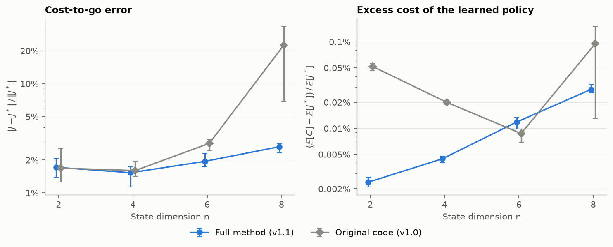
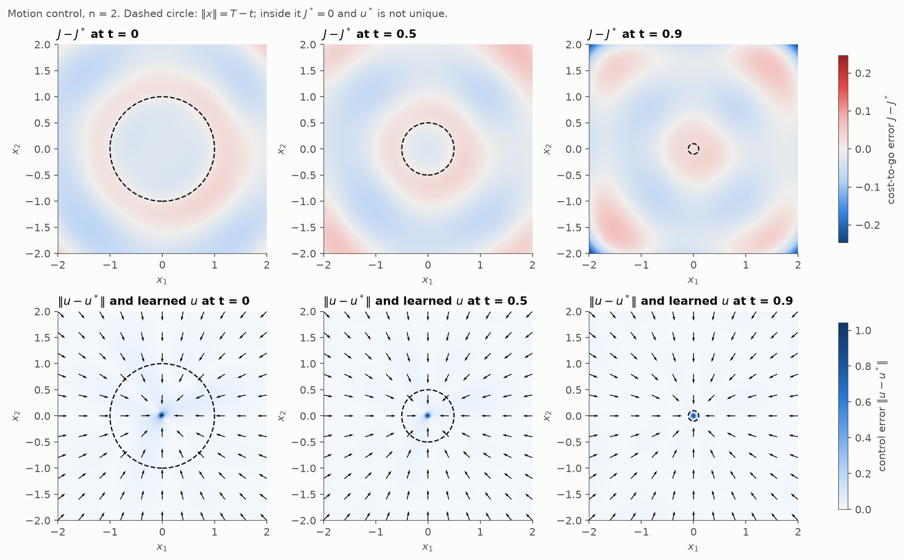
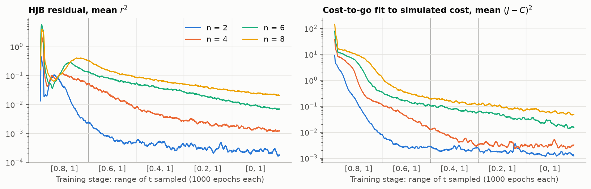
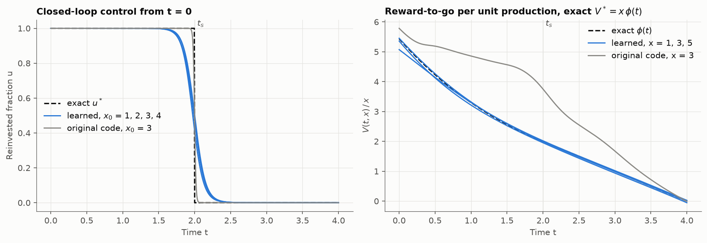
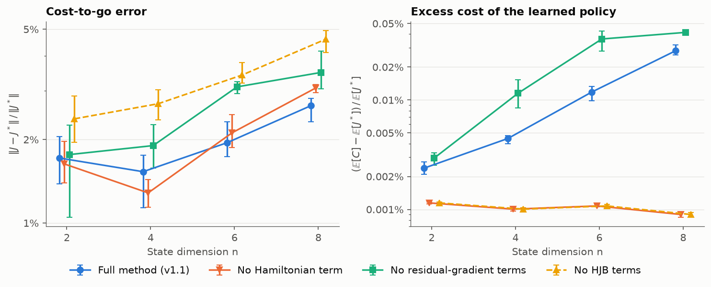

# Neural Network Solutions for Hamilton-Jacobi-Bellman Equations

This repository trains a policy network $u(t, x)$ and a cost-to-go network $J(t, x)$ for finite-horizon optimal control problems, using the Hamilton-Jacobi-Bellman (HJB) equation together with simulated closed-loop cost. Both test problems have closed-form solutions (they are classic examples from Bertsekas, *Dynamic Programming and Optimal Control*, Vol. I, Ch. 7), so every number below is an error against the exact answer:

1. **Motion control**: drive a point in $\mathbb{R}^n$ to the origin at bounded speed, $n = 2, 4, 6, 8$
2. **Resource allocation**: split production between reinvestment and consumption; the optimal control is bang-bang

**Results** (mean of 3 seeds, against the exact solutions): the learned cost-to-go is within 1.5–2.6% relative error for motion control in 2 to 8 dimensions and 1.0% for resource allocation, and the learned policies cost at most 0.03% more than optimal (motion control) and earn 0.1% less (resource allocation). Version 1.0 of this repository had errors in its losses and overstated its results; [What changed in v1.1](#what-changed-in-v11) lists them, and the tables below compare against the v1.0 code.

## Method

A finite-horizon control problem

$$\min_{u(\cdot)} \int_t^T g(s, x, u)\,ds + h(x(T)) \quad \text{subject to} \quad \dot x = f(s, x, u)$$

has a cost-to-go $J(t, x)$ that solves the HJB equation

$$J_t + \min_u \big[ J_x \cdot f(t, x, u) + g(t, x, u) \big] = 0, \qquad J(T, x) = h(x).$$

Two networks are trained together: a policy $u_\theta(t, x)$, mapped into the control set, and a cost-to-go $J_\phi(t, x)$. Both are MLPs with two tanh hidden layers of 64 units; the cost-to-go output is multiplied by a fixed scale (the typical size of $J$ for the problem) so the network works at $O(1)$. With $u = u_\theta(t, x)$ and the Hamiltonian $H(t, x, u, p) = p \cdot f(t, x, u) + g(t, x, u)$, the loss is the unweighted sum of:

| Term | Loss | Trains |
|---|---|---|
| `hjb` | $r^2$, with residual $r = J_t + H(t, x, u, J_x)$ | cost-to-go |
| `hjb_dt`, `hjb_dx` | $(\partial_t r)^2$ and $\lVert \partial_x r \rVert^2$, with $u$ held fixed; these also vanish at the exact solution | cost-to-go |
| `hamiltonian` | $H(t, x, u_\theta, J_x)$ with $J$ held fixed, which pushes $u_\theta$ toward $\arg\min_u H$ | policy |
| `terminal` | $(J(T, x) - h(x))^2$ | cost-to-go |
| `policy` | $C(t, x)$, the cost of simulating $u_\theta$ from $(t, x)$ to $T$, differentiated through an RK4 solve | policy |
| `value_fit` | $(J(t, x) - C(t, x))^2$, with $C$ held fixed | cost-to-go |

Every term is built from $f$, $g$ and $h$ by automatic differentiation, so adding a problem means writing those (and, for scoring, the exact solution) in a subclass of `neural_hjb.ControlProblem`.

Training runs backward in time over five stages of 1000 Adam steps (learning rate $10^{-3}$, batch 128): stage $k$ samples $t$ uniformly in $[kT/5,\, T]$ and $x$ uniformly from the problem's domain, so the horizon grows from the last fifth of $[0, T]$ to all of it.

## Problems

### Motion control

$$\min_u \lVert x(T) \rVert^2 \quad \text{subject to} \quad \dot x = u,\ \lVert u \rVert \le 1,\ x \in \mathbb{R}^n,\ T = 1.$$

The optimal control heads straight for the origin at full speed, $u^* = -x / \lVert x \rVert$, and

$$J^*(t, x) = \max\big(0,\ \lVert x \rVert - (T - t)\big)^2.$$

Inside the ball $\lVert x \rVert \le T - t$ the origin is reachable, $J^* = 0$, and any control that reaches it by $T$ is optimal, so control errors are only measured outside that ball. Training and test states are drawn from $[-2, 2]^n$.

### Resource allocation

$$\max_u \int_0^T (1 - u)\,x\,dt \quad \text{subject to} \quad \dot x = \gamma u x,\ u \in [0, 1],\ \gamma = 0.5,\ T = 4.$$

$x$ is a production rate; the fraction $u$ is reinvested and the rest consumed. The optimal control is bang-bang: reinvest everything until $t_s = T - 1/\gamma = 2$, then consume everything. The optimal reward-to-go is $V^*(t, x) = x\,\phi(t)$ with $\phi(t) = T - t$ for $t \ge t_s$ and $\phi(t) = e^{\gamma (t_s - t)}/\gamma$ for $t < t_s$. In the code the problem is written as minimization, with $g = -(1 - u)x$ and $J = -V$. Training and test states are drawn from $[1, 5]$.

## Results

All numbers are means over 3 seeds on 4096 fixed test points $(t, x)$ with $t$ uniform in $[0, T]$; per-run values are in `<problem>/results/metrics.csv`. *Original* is the v1.0 code (commit `cb6fef7`), retrained here with the same seeds and scored by the same evaluation; `run.sh` regenerates every row except these.

- **Cost-to-go error**: $\lVert J - J^* \rVert / \lVert J^* \rVert$ over the test points.
- **Excess cost**: simulate the learned policy from every test point to $T$ and compare its cost $C$ with the optimum, $(\mathbb{E}[C] - \mathbb{E}[J^*]) / \mathbb{E}[J^*]$. For resource allocation this is the fraction of the optimal reward lost.

### Motion control

| n | Cost-to-go error, v1.1 | Cost-to-go error, original | Excess cost, v1.1 | Excess cost, original |
|---|---|---|---|---|
| 2 | 1.7% | 1.7% | 0.0024% | 0.052% |
| 4 | 1.5% | 1.6% | 0.0045% | 0.020% |
| 6 | 1.9% | 2.8% | 0.012% | 0.0087% |
| 8 | 2.6% | 22.6% | 0.028% | 0.096% |

The v1.0 policies were already close to optimal (and marginally better at n = 6); the main gain is the cost-to-go at n = 8, which v1.0 had off by 23%. As a mean-squared error (the metric the v1.0 README reported), the v1.1 cost-to-go reaches 0.0012, 0.0040, 0.015 and 0.051 for n = 2, 4, 6, 8, against 0.0012, 0.0044, 0.032 and 4.6 for the retrained v1.0 code.


*The table above as a function of dimension. Points are means over 3 seeds and bars span the seeds.*


*n = 2, full method, seed 0. Top: cost-to-go error, within ±0.25 everywhere and largest in the corners of the box near $T$. Bottom: control error with the learned control field; the error is confined to the origin, where $u^*$ is undefined.*


*HJB residual and cost-to-go fit during training (full method, seed 0), smoothed over 50 epochs. Each stage extends the range of sampled $t$ backward by $T/5$.*

### Resource allocation

| | Reward-to-go error | Reward lost by policy | Worst switching-time error |
|---|---|---|---|
| v1.1 | 1.0% | 0.10% | 0.032 |
| Original | 62% | 0.0029% | 0.020 |

The switching-time error is $\lvert t_{\text{switch}} - t_s \rvert$ for closed-loop paths started at $t = 0$ from nine initial states in $[1, 5]$, with $t_{\text{switch}}$ the time the control crosses 1/2.

The v1.0 reward-to-go was wrong because its HJB loss was: at the exact solution its three residual terms evaluate to 21, 1.8 and 43 instead of 0. Its policy was nonetheless accurate, because the policy learned from the simulated reward, which was correct. It also switches more sharply than v1.1's, which smooths the switch over a few tenths of a time unit and gives up about 0.1% of the reward. Training with 100 instead of 40 RK4 steps per rollout did not sharpen it.


*Full method, seed 0, with the v1.0 code (seed 0) in gray. Left: control along closed-loop paths; the four learned paths from $x_0 = 1, \dots, 4$ nearly coincide. Right: learned reward-to-go divided by $x$, which should match the exact $\phi(t)$ for every $x$.*

### What each loss term contributes

Every variant below was trained with the same seeds and settings, with the named terms removed.

**Motion control**, cost-to-go error / excess cost:

| Variant | n = 2 | n = 4 | n = 6 | n = 8 |
|---|---|---|---|---|
| Full method | 1.7% / 0.0024% | 1.5% / 0.0045% | 1.9% / 0.012% | 2.6% / 0.028% |
| No `hamiltonian` | 1.6% / 0.0011% | 1.3% / 0.0010% | 2.1% / 0.0011% | 3.1% / 0.0009% |
| No `hjb_dt`, `hjb_dx` | 1.8% / 0.0029% | 1.9% / 0.012% | 3.1% / 0.036% | 3.5% / 0.042% |
| No HJB terms (only `terminal`, `value_fit`, `policy`) | 2.4% / 0.0011% | 2.7% / 0.0010% | 3.4% / 0.0011% | 4.6% / 0.0009% |


*The motion-control table above as a function of dimension (bars span the 3 seeds). The two variants without the `hamiltonian` term train identical policies, so their excess costs coincide.*

**Resource allocation**:

| Variant | Reward-to-go error | Reward lost by policy | Seeds stuck at "always consume" |
|---|---|---|---|
| Full method | 1.0% | 0.10% | 0 of 3 |
| No `hamiltonian` | 6.3% | 3.3% | 1 of 3 |
| No `hjb_dt`, `hjb_dx` | 1.3% | 0.15% | 0 of 3 |
| No HJB terms | 6.6% | 3.3% | 1 of 3 |

- **The HJB residual improves the cost-to-go.** Fit to simulated cost alone, the cost-to-go error is 1.4–1.8× larger in motion control, and 1.5× larger in resource allocation on the seeds whose policy converged.
- **The residual-gradient terms improve both networks.** Without them the cost-to-go error rises at every dimension, and so does the excess cost, consistent with the `hamiltonian` term steering the policy with a less accurate $J_x$.
- **The `hamiltonian` term is the only way the cost-to-go informs the policy, and it cuts both ways.** Without it the policy learns from simulated cost alone, so the two variants without it train identical policies. In motion control that policy is the most accurate (excess cost about 0.001% at every dimension), and steering it toward the minimizer of an approximate Hamiltonian adds a small bias. In resource allocation, simulated cost alone left 1 of 3 seeds at the local optimum of consuming everything from the start, which loses 9.6% of the reward; with the term, all 3 seeds found the switch. Three seeds make this suggestive rather than conclusive.

### Limitations

Both problems are low-dimensional textbook examples with closed-form solutions, and the method has not been compared with other neural HJB solvers (e.g. Deep BSDE or DGM) or tuned per problem; all runs share one architecture and one set of hyperparameters.

## Installation

```bash
git clone https://github.com/rfarell/neural_hbj.git
cd neural_hbj
./setup.sh                 # creates the conda env "neural_hjb" and runs pip install -e ".[dev]"
conda activate neural_hjb
```

Or, in any Python 3.9+ environment: `pip install -e ".[dev]"`.

## Usage

```bash
pytest                     # exact solutions satisfy the losses; a tiny end-to-end run works
./run.sh                   # train and evaluate everything in the tables above
VARIANTS=full SEEDS=0 ./run.sh   # just the method, one seed (about 15 minutes)
```

Or run the steps yourself from the repository root:

```bash
python -m motion_control.train --dims 2 4 6 8 --variants full --seeds 0 1 2
python -m motion_control.evaluate
python -m resource_allocation.train --variants full --seeds 0 1 2
python -m resource_allocation.evaluate
```

Training skips runs that already have a checkpoint (pass `--force` to retrain) and runs `--jobs` single-threaded runs in parallel. Checkpoints and per-epoch loss logs go to `<problem>/models/` (not tracked); metrics and figures go to `<problem>/results/`. `--help` lists the remaining options (epochs, stages, batch size, learning rate, width, RK4 steps).

## Repository layout

```
neural_hjb/               shared solver
  problem.py              ControlProblem interface: f, g, h, domain, exact solution
  networks.py             PolicyNet (control constraints), ValueNet
  solver.py               HJB losses, closed-loop rollout, staged training
  experiment.py           checkpoints, parallel training grid
motion_control/           problem.py, train.py, evaluate.py, results/
resource_allocation/      problem.py, train.py, evaluate.py, results/
tests/                    exact-solution checks and an end-to-end smoke test
```

## What changed in v1.1

Version 1.0 (commit `cb6fef7`) had the following problems, each fixed here.

**Losses**

- **The resource-allocation HJB loss was wrong.** The running reward entered the residual with the wrong sign (the value network was fit to the reward while the residual treated it as a cost), and the two derivative terms were not derivatives of the HJB equation. At the exact solution the three terms evaluated to 21, 1.8 and 43 instead of 0, and the learned reward-to-go was off by 62%. Residuals are now built from $f$, $g$ and $h$ by autograd for every problem, and `tests/test_hjb.py` checks that both exact solutions make every residual vanish.
- **The HJB residual trained the policy.** Minimizing $r^2$ over $u$ only minimizes the Hamiltonian if $J$ is exact; while $J$ is inaccurate it can push the policy toward worse controls. The residual terms now train only the cost-to-go, and the policy learns from the `hamiltonian` term and the simulated cost.
- **The value-fit term trained the policy.** $(J - C)^2$ let the policy reduce the loss by moving its cost toward the value network's prediction. $C$ is now held fixed.
- **Collocation points sat only at stage start times.** Each stage sampled $t$ only at its start $t_k$, never inside $[t_k, T]$; $t$ is now uniform over the stage's horizon.
- **The cost-to-go output was unscaled.** $J$ reaches 32 in 8-D, far from the $O(1)$ outputs a freshly initialized network produces; without scaling, the 8-D terminal loss in this code stayed near 11 through the first three of the five stages. The output is now multiplied by the problem's typical cost.
- **The policy objectives were squared.** Motion control minimized $\mathbb{E}[h(x(T))^2]$ and resource allocation maximized $\mathbb{E}[C^2]$; both now optimize the cost itself.

**Evaluation and reporting**

- The README stated a running cost $\int \lVert x \rVert^2$ for motion control that the code did not have (the code is terminal-cost only, which is what the exact solution assumes).
- It said accuracy was maintained up to 8-D while its own 8-D cost-to-go MSE was 4.2 (2.95 in the committed CSV, a different run). Its tables did not match the committed results, and its "switching time accuracy ±0.05" was not computed anywhere.
- The resource-allocation value network was never evaluated, and the motion-control control error included states where the optimal control is not unique.
- Results now come from 3 seeds on fixed test sets, include the cost the learned policy actually achieves, and are generated by `evaluate.py`.

**Code**

- `run.sh` required a conda environment named `neural_hjb`, but `setup.sh` named it after the checkout folder, so `run.sh` failed in a clone named anything else.
- The scripts only worked from inside their own directory. They now run as modules from the repository root.
- The two problems duplicated the networks, losses and training loop. These now live in the shared `neural_hjb` package.
- The adaptive (dopri5) rollouts are replaced with fixed-step RK4, and there are now tests, seeds, parallel training and resumable runs.

## Citation

```bibtex
@software{neural_hjb,
  author = {Farell, Ryan},
  title = {Neural Network Solutions for Hamilton-Jacobi-Bellman Equations},
  year = {2024},
  url = {https://github.com/rfarell/neural_hbj}
}
```

## License

MIT License - see LICENSE file for details.
